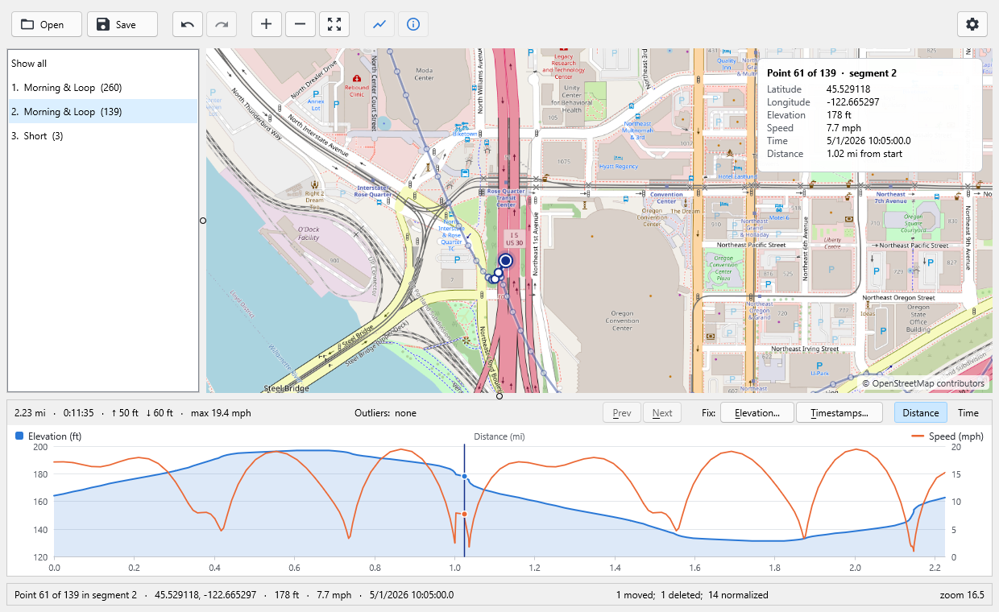
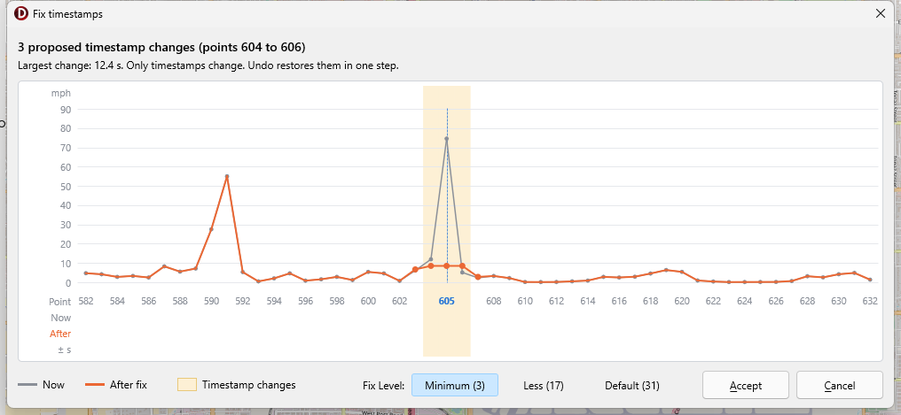
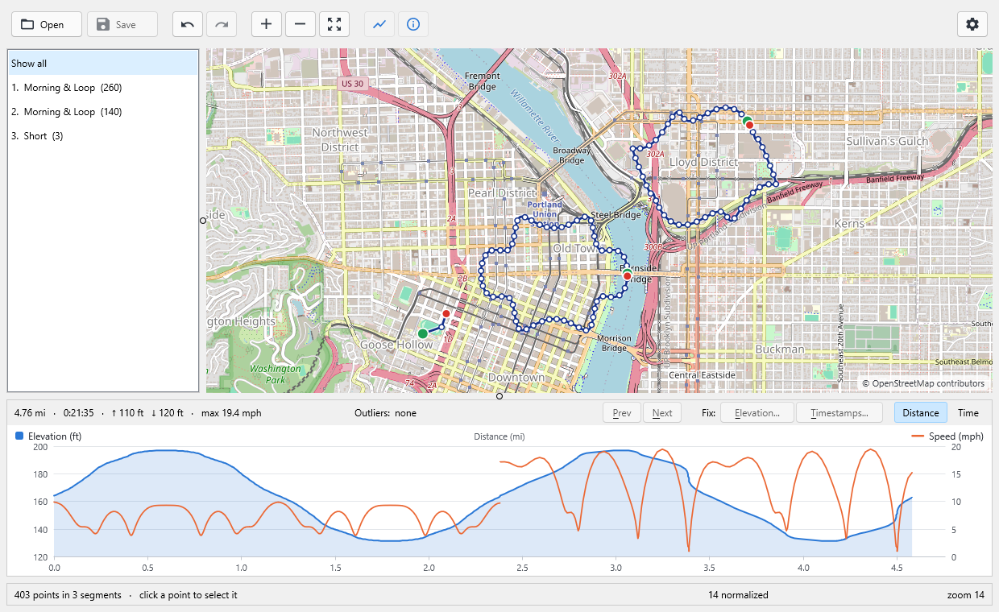
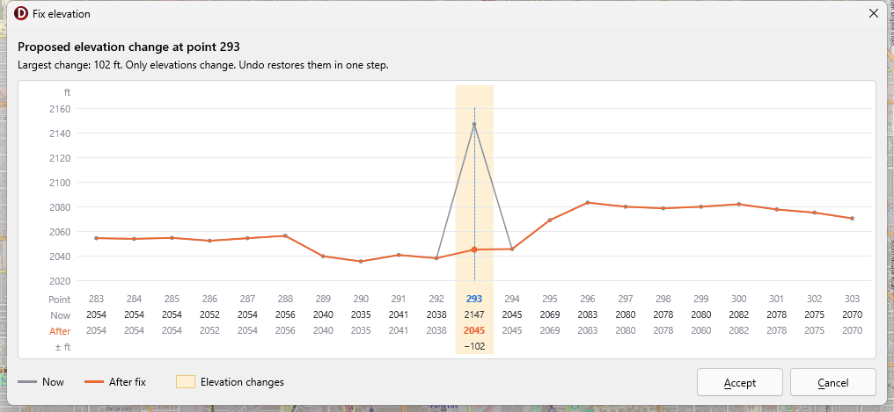

# TrackMender

Frankie's GPX Track Mender is a Windows app for editing recorded GPX tracks on a map.
It edits the relevant parts of the GPX and keeps the surrounding XML text. Each save
keeps the previous version as a `.bak` file next to the GPX.

## Edit a track

Open a GPX file or drop it onto the window. Click a point, then drag it, nudge it with
Ctrl+arrows, delete it, or insert a point after it. The info card shows the selected
point's position, elevation, speed, time, and distance from the start of its segment.
Use Ctrl+Z to undo and Ctrl+Y to redo while the file is open.

## Fix a timestamp glitch

A timestamp that's a little early or late can show up as a speed spike on an otherwise
steady stretch. Select a point near the spike and choose **Fix: Timestamps**. Compare the
speeds before and after. If the preview offers a lower **Fix Level**, try it before accepting.
**Accept** applies the timestamp edits. **Save** writes them to disk.

## Work one segment at a time

Files with more than one track segment get a segment list. Pick one to show and edit it on
its own, or show them all.

## Check elevation and speed

Plot elevation and speed against distance or clock time. Click the graph to select a
point, or use F8 and Shift+F8 to jump between flagged readings. The units menu offers
imperial, metric, aviation, and marine units.

**Fix: Elevation** works the same way for elevation. It previews new values for the selected
point and any out-of-line points next to it, taken from the good points on either side. Use
**Normalize** to repair missing or implausible elevations and missing or out-of-order
timestamps where the segment has enough usable readings.

## Keyboard shortcuts

| Key | Action |
|---|---|
| Left / Right | Previous / next point |
| Home / End | First / last point |
| Ctrl+arrows | Nudge the selected point (Shift for bigger steps) |
| Del / Ins | Delete the point / insert one after it |
| Ctrl+Z / Ctrl+Y | Undo / redo |
| + / - / F6 | Zoom in / out / fit the track |
| F7 / Shift+F7 | Fix elevation / fix timestamps |
| F8 / Shift+F8 | Next / previous outlier |
| Ctrl+G | Show or hide the graph |
| Ctrl+O / Ctrl+S | Open / save |
| Ctrl+Shift+S | Save as |
| F1 | About |

## Building

| Folder | Toolchain | Build |
|---|---|---|
| `D12` | Delphi with FireMonkey and the Win64 compiler | Open `TrackMender.dproj` or run `D12\build.bat` |
| `LAZ` | Lazarus 4.x with Free Pascal 3.2.2 and the BGRABitmap package | Open `TrackMender.lpi` or run `LAZ\build.bat` |

Both batch files default to `Release` and also accept `Debug`. The Delphi batch file
points to Delphi 13 (Studio 37.0) under `Program Files (x86)`. For a different install,
open the project in the IDE or update the path to `rsvars.bat` in `D12\build.bat`.
This checkout targets Delphi 12 and later. The command-line build was verified on
Delphi 13.

For Lazarus, install BGRABitmap through the Online Package Manager. The build script
checks `C:\lazarus`, then `D:\lazarus`, then looks for `lazbuild` on `PATH`.

Edit the shared Pascal units in `D12`, then run `python sync_laz.py` from the project
root to update `LAZ`. Edit each form and project file in its own IDE. The Lazarus-only
units (`uFmx`, `uCompat`, and `uHttp`) are maintained by hand.

Settings are kept in `settings.json` in the user's application data folder
(`%APPDATA%\TrackMender` on Windows). The map tile source and API key are set in the
program: gear button, then Settings.

## Acknowledgements

- Map data © [OpenStreetMap](https://www.openstreetmap.org/copyright) contributors. By default
  tiles come from the OpenStreetMap tile servers, which are run by volunteers; please respect
  their [usage policy](https://operations.osmfoundation.org/policies/tiles/) or use
  another provider (gear button, then Settings).
- The map picture behind the About box is from the [CyclOSM](https://www.cyclosm.org) layer,
  which is drawn from OpenStreetMap data.
- The Lazarus build draws with [BGRABitmap](https://github.com/bgrabitmap/bgrabitmap) and uses
  the Lazarus LCL and Free Pascal run-time library (LGPL with linking exception).

## License

[MIT](LICENSE). Provided as is, without warranty of any kind.
